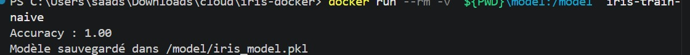
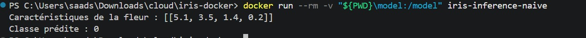
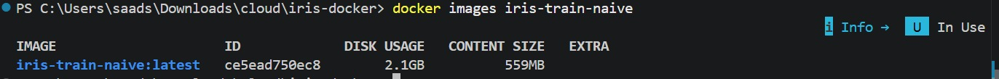
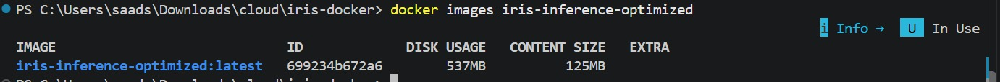
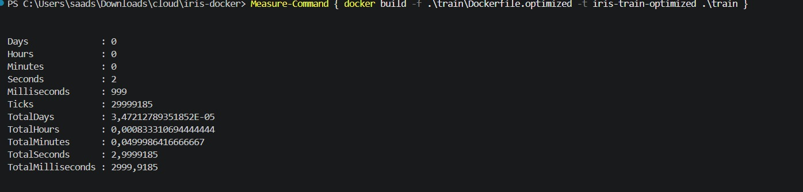
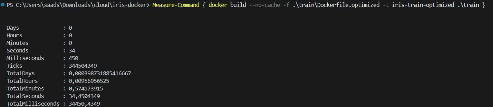
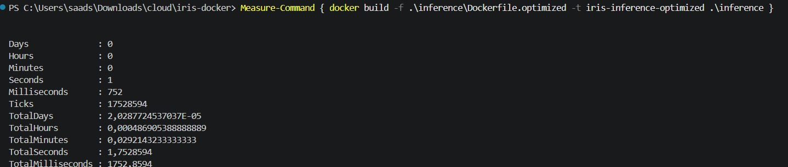
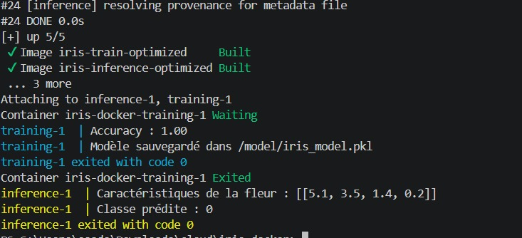
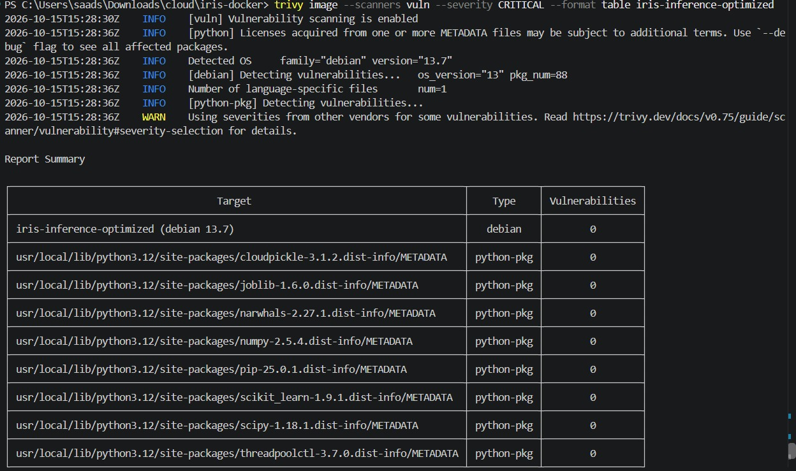

# Iris ML — Docker, FastAPI et Redis

**De l'entraînement d'un modèle à son exposition via une API conteneurisée.**

Ce dépôt regroupe deux travaux pratiques réalisés autour du jeu de données **Iris**. Le premier porte sur la conteneurisation d'un pipeline de Machine Learning, la comparaison d'images Docker et leur analyse de sécurité. Le second reprend le modèle entraîné pour le rendre accessible par une API **FastAPI**, avec **Redis** pour compter les prédictions.

L'objectif n'était pas de développer un modèle complexe, mais de travailler sur les étapes qui entourent sa mise en service : reproductibilité, construction des images, orchestration, communication entre conteneurs et persistance des données.

## Environnement technique

**Python 3.12** · **scikit-learn** · **Random Forest** · **Joblib** · **Docker** · **Docker Compose** · **Trivy** · **FastAPI** · **Uvicorn** · **Redis**

## Organisation du dépôt

```text
iris-docker/
├── train/                  # Entraînement et Dockerfiles naïf / optimisé
├── inference/              # Prédiction et Dockerfiles naïf / optimisé
├── api/                    # API FastAPI et son Dockerfile
├── model/
│   └── iris_model.pkl      # Modèle entraîné, partagé entre les services
├── screenshots/            # Captures des manipulations du TP 1
├── compose.yaml            # TP 1 : entraînement puis inférence
├── compose.tp4.yaml        # TP 2 : API et Redis
├── .gitignore
└── README.md
```

---

# TP 1 — Conteneurisation et optimisation du modèle Iris

## 1. Entraîner et sauvegarder le modèle

Le script `train/train.py` charge Iris depuis scikit-learn, sépare les données en ensembles d'entraînement et de test, puis entraîne un `RandomForestClassifier` avec **100 arbres** (`random_state=42`). Le modèle est enregistré avec Joblib pour être réutilisé sans nouvel entraînement.

Construire et exécuter l'image naïve depuis la racine du dépôt (PowerShell) :

```powershell
docker build -t iris-train-naive ./train
docker run --rm -v "${PWD}\model:/model" iris-train-naive
```

**Résultat observé :** accuracy de **1,00** sur le jeu de test et création du fichier `/model/iris_model.pkl`.



## 2. Exécuter une inférence

L'image d'inférence recharge le modèle sauvegardé et prédit la classe d'une fleur à partir de quatre mesures : longueur et largeur du sépale, longueur et largeur du pétale.

```powershell
docker build -t iris-inference-naive ./inference
docker run --rm -v "${PWD}\model:/model" iris-inference-naive
```

Pour l'échantillon `[5.1, 3.5, 1.4, 0.2]`, la classe prédite est **0 (Iris setosa)**.



## 3. Comparer les images Docker

J'ai d'abord construit une version simple à partir de `python:3.12`, puis une version optimisée avec `python:3.12-slim`, un build multi-étapes, des dépendances ciblées et un `.dockerignore`.

| Mesure (CONTENT SIZE) | Image naïve | Image optimisée | Réduction |
|---|---:|---:|---:|
| Entraînement | 559 MB | 125 MB | ≈ 77,6 % |
| Inférence | 559 MB | 125 MB | ≈ 77,6 % |

**Image naïve — entraînement :**



**Image optimisée — inférence :**



Les images d'entraînement et d'inférence présentent les mêmes tailles de contenu dans les mesures réalisées. Le passage de **559 MB à 125 MB** représente une réduction d'environ **77,6 %**. La colonne `CONTENT SIZE` est distincte de `DISK USAGE` dans l'affichage de Docker.

## 4. Mesurer les temps de construction

Pour comparer les builds, j'ai utilisé `Measure-Command` dans PowerShell :

- **Build à chaud :** réutilise les couches disponibles dans le cache Docker.
- **Build à froid :** utilise `--no-cache` pour reconstruire les couches.

### Entraînement — build à chaud

```powershell
Measure-Command { docker build -f .\train\Dockerfile.optimized -t iris-train-optimized .\train }
```

**Mesure de la capture : 3,00 s.**



### Entraînement — build à froid

```powershell
Measure-Command { docker build --no-cache -f .\train\Dockerfile.optimized -t iris-train-optimized .\train }
```

**Mesure de la capture : 34,45 s.**



### Inférence — build à chaud

```powershell
Measure-Command { docker build -f .\inference\Dockerfile.optimized -t iris-inference-optimized .\inference }
```

**Mesure de la capture : 1,75 s.**



Ces temps correspondent à des exécutions sur ma machine : ils dépendent du cache Docker, des dépendances et de l'environnement de construction. Ils ne constituent pas des temps universels.

## 5. Orchestrer l'entraînement et l'inférence

Le fichier `compose.yaml` définit deux services. L'inférence ne démarre qu'une fois l'entraînement terminé avec succès. Les deux services partagent le dossier `model/`.

```powershell
docker compose up --build
```

La sortie confirme l'enchaînement attendu : **accuracy 1,00**, sauvegarde du modèle, puis prédiction de la **classe 0**. Les deux services se terminent avec le **code 0**.




## 6. Analyser les vulnérabilités avec Trivy

Enfin, j'ai comparé les vulnérabilités critiques détectées dans les images. Le scan de l'image d'entraînement naïve avait signalé **16 vulnérabilités critiques**. Après passage aux images optimisées, les scans présentés ci-dessous ne signalent **aucune vulnérabilité critique** pour l'entraînement et l'inférence.

```powershell
trivy image --scanners vuln --severity CRITICAL --format table iris-train-optimized
trivy image --scanners vuln --severity CRITICAL --format table iris-inference-optimized
```

**Scan de l'image d'entraînement optimisée :**


**Scan de l'image d'inférence optimisée :**



Ce résultat concerne uniquement les vulnérabilités classées `CRITICAL` au moment du scan ; il ne signifie pas que les images sont exemptes de toute vulnérabilité. Le choix d'une image de base plus légère réduit notamment la surface de dépendances système à analyser.

---

# TP 2 — Exposer le modèle avec FastAPI et Redis

## Objectif

Dans ce deuxième TP, j'ai réutilisé `iris_model.pkl` pour construire une API HTTP. Le modèle n'est plus appelé directement depuis un script d'inférence : il est chargé par un service **FastAPI**. Un second conteneur, **Redis**, enregistre le nombre de prédictions effectuées.

## Architecture

```text
Client HTTP / Swagger UI
           |
           v
       FastAPI :8000
       |         |
       |         +----> Redis (service "base", port 6379)
       |                      |
       v                      v
 iris_model.pkl         Volume redis_data
```

Les deux services sont déclarés dans `compose.tp4.yaml`. Docker Compose leur fournit un réseau commun ; l'API peut donc joindre Redis avec le nom d'hôte `base`. Le modèle est monté en lecture seule et Redis utilise un volume nommé pour ses données.

## Routes disponibles

| Méthode | Route | Fonction |
|---|---|---|
| GET | `/` | Vérifier que l'API répond |
| POST | `/predict` | Prédire la classe Iris et incrémenter le compteur Redis |
| GET | `/stats` | Consulter le nombre de prédictions enregistrées |

**Exemple de requête vers `/predict` :**

```json
{
  "sepal_length": 5.1,
  "sepal_width": 3.5,
  "petal_length": 1.4,
  "petal_width": 0.2
}
```

**Réponse obtenue :**

```json
{
  "prediction": 0
}
```

**Exemple de réponse de `/stats` après deux prédictions :**

```json
{
  "total_predictions": 2
}
```

## Démarrage

Depuis la racine du dépôt, avec Docker Desktop en cours d'exécution :

```powershell
# Si nécessaire, générer le modèle avant de lancer l'API
docker compose up --build

# Démarrer FastAPI et Redis
docker compose -f compose.tp4.yaml up -d --build
```

- **Documentation interactive :** http://localhost:8000/docs
- **Statistiques :** http://localhost:8000/stats

Pour consulter directement la valeur du compteur dans Redis :

```powershell
docker compose -f compose.tp4.yaml exec base redis-cli GET prediction_count
```

## Vérification de la persistance

Après deux appels à `/predict`, Redis renvoyait `"2"`. J'ai ensuite testé deux comportements différents :

| Manipulation | Observation |
|---|---|
| `docker compose -f compose.tp4.yaml down` puis `up -d` | Le compteur reste à **2** |
| `docker compose -f compose.tp4.yaml down -v` puis `up -d` | Le compteur est réinitialisé : `/stats` renvoie **0** |

La différence vient du volume nommé `redis_data` : `down` conserve le volume, tandis que `down -v` le supprime. Ce test permet de distinguer le cycle de vie des conteneurs de celui des données.

## Conclusion

Ces deux TP couvrent le passage d'un modèle entraîné à une application conteneurisée : **entraînement, inférence, optimisation des images, analyse de sécurité, orchestration, API REST et persistance des données**. Le projet met en pratique les principaux mécanismes nécessaires pour exécuter et exposer un modèle de Machine Learning dans un environnement Docker reproductible.
